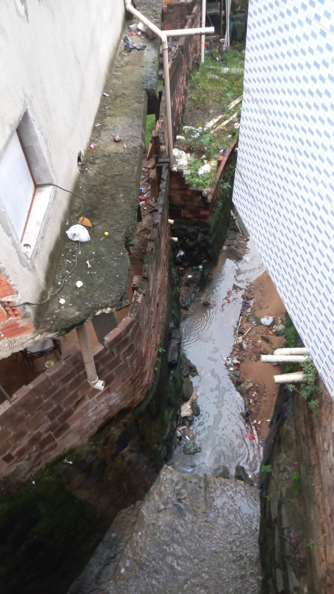
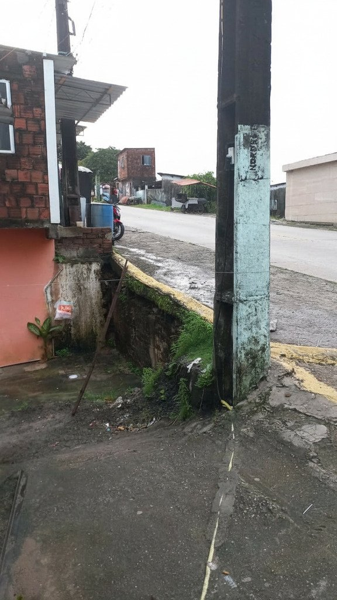
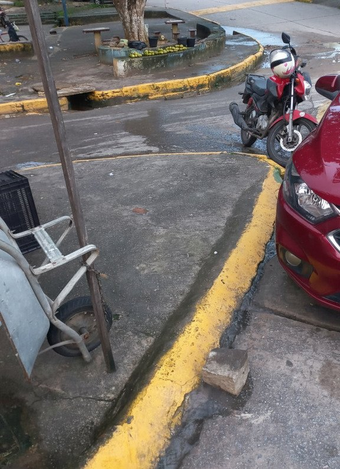
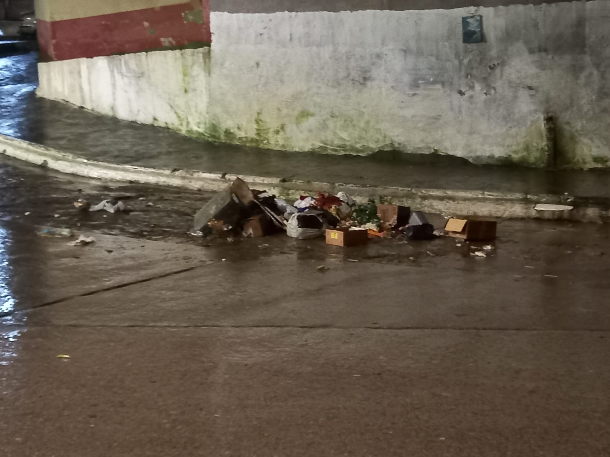

# EcoGuararapes 🌿⛈️

[](https://github.com/renan-pereira-dev/EcoGuararapes/actions/workflows/tests.yml)

> **Summary (English)**
> EcoGuararapes is a university extension project (Systems Analysis and Development, Wyden) about urban drainage and illegal waste disposal in Jaboatão dos Guararapes, Pernambuco, Brazil. It started as a field survey in the Muribeca community and is evolving into a citizen platform where residents can view and report problems such as littering, blocked drains and flooding on a moderated map.
> The current repository contains the field survey evidence and a Python script that removes EXIF metadata from photos and resizes them before publication. The web platform (v1), AI-assisted triage (v2), rainfall analysis (v3) and a custom image classifier (v4) are **planned**, not implemented yet.
> Guiding principle: first build a reliable system for data collection, privacy, moderation and visualization; then add AI and analytical models that can be evaluated with real data.

---

## 📌 Sobre o projeto

**Projeto de Extensão Universitária** · Curso: Análise e Desenvolvimento de Sistemas (ADS) · Jaboatão dos Guararapes - PE

O **EcoGuararapes** nasceu de uma pesquisa de campo na comunidade da **Muribeca**, em Jaboatão dos Guararapes, sobre descarte irregular de resíduos, obstrução de canais e bueiros e alagamentos. Segundo reportagem do G1 Pernambuco (2026), durante um episódio de fortes chuvas, mais de 60% do bairro da Muribeca ficou debaixo d'água.

A proposta é transformar essa documentação em uma **plataforma digital de participação cidadã** com dois objetivos:

- **Informar:** moradores consultam um mapa com os locais que têm ocorrências registradas, seus tipos e seu estado de validação.
- **Registrar:** moradores comunicam novos problemas, inclusive alagamentos observados durante ou depois da chuva, com descrição, localização e foto opcional.

Todo registro passa por **moderação** antes de aparecer no mapa público. "Aprovada" significa que a ocorrência passou pela moderação da plataforma. Não significa que uma autoridade pública confirmou o evento, nem que o problema foi resolvido.

> ⚠️ **Aviso:** o EcoGuararapes é uma ferramenta comunitária de registro e visualização. **Não** é um sistema oficial da prefeitura, **não** é canal de emergência, não garante resposta de órgãos públicos e não substitui as orientações da Defesa Civil. Em caso de risco imediato, procure os canais oficiais de emergência.

### 🔒 Privacidade

- Nenhuma foto é publicada com metadados EXIF, que podem conter GPS, data e modelo do celular.
- Rostos, placas de veículos e interiores de residências devem ser ocultados antes da publicação.
- O repositório não guarda dados pessoais nem coordenadas exatas de residências.
- As fotos originais ficam fora do Git, na pasta ignorada `imagens_originais/`.

---

## 📸 Evidências de campo

As evidências abaixo foram registradas presencialmente e estão listadas em [`data/field_survey.csv`](data/field_survey.csv). As imagens publicadas foram geradas pelo script [`prepare_images.py`](scripts/prepare_images.py), sem metadados EXIF.

| # | Data | Imagem | Descrição | Impacto |
|---|------|--------|-----------|---------|
| 1 | 27/05/2026 | [`2026-05-27_01_open-canal-with-trash.jpg`](docs/field-survey/images/2026-05-27_01_open-canal-with-trash.jpg) | Canal a céu aberto entre residências, com lixo doméstico, entulho e água parada. | Obstrui a drenagem, expõe esgoto e atrai vetores como ratos e baratas. |
| 2 | 27/05/2026 | [`2026-05-27_02_damaged-drain-near-utility-pole.jpg`](docs/field-survey/images/2026-05-27_02_damaged-drain-near-utility-pole.jpg) | Ponto de escoamento degradado junto a um poste de energia, com vegetação nas fendas da estrutura. | Bloqueia o fluxo da água e causa erosão perto da rede elétrica. |
| 3 | 27/05/2026 | [`2026-05-27_03_concrete-block-blocking-gutter.jpg`](docs/field-survey/images/2026-05-27_03_concrete-block-blocking-gutter.jpg) | Bloco de concreto solto na sarjeta de uma esquina, retendo a água da chuva. | Pequenas barreiras físicas bastam para iniciar alagamentos superficiais. |
| 4 | 28/05/2026 | [`2026-05-28_01_trash-on-street-in-rain.jpg`](docs/field-survey/images/2026-05-28_01_trash-on-street-in-rain.jpg) | Embalagens, papelão e plásticos descartados na calçada e na sarjeta, à noite, sob chuva. | A enxurrada arrasta os resíduos para os bueiros e causa entupimentos. |

<p align="center">
  
  
  
  
</p>

---

## 🖼️ Preparando imagens para publicação

O script [`scripts/prepare_images.py`](scripts/prepare_images.py) lê o arquivo `data/field_survey.csv` e, para cada foto listada:

1. corrige a orientação da foto usando a tag EXIF de rotação;
2. remove **todos** os metadados EXIF, incluindo o GPS;
3. redimensiona a foto para no máximo 1600 px de largura ou altura, mantendo a proporção;
4. salva o resultado em `docs/field-survey/images/` com o nome `YYYY-MM-DD_NN_slug.jpg`.

### Formato do CSV

```csv
original_file,date,slug
imagens_originais/WhatsApp_Image_2026-05-27_at_16.42.04.jpeg.jpeg,2026-05-27,open-canal-with-trash
```

- `original_file`: caminho da foto original, relativo à raiz do projeto.
- `date`: data em que a foto foi tirada (`YYYY-MM-DD`).
- `slug`: descrição curta em inglês, com palavras separadas por hífen.

O número `NN` é gerado automaticamente, na ordem em que as fotos de uma mesma data aparecem no CSV.

### Como executar

Requer Python 3.

```bash
# 1. Criar e ativar um ambiente virtual
python -m venv venv
venv\Scripts\activate        # Windows
source venv/bin/activate     # Linux/macOS

# 2. Instalar as dependências
pip install -r requirements.txt      # apenas para rodar o script
pip install -r requirements-dev.txt  # script + pytest, para rodar os testes

# 3. Colocar as fotos originais em imagens_originais/ e registrá-las no CSV

# 4. Gerar as imagens limpas
python scripts/prepare_images.py

# 5. Rodar os testes
pytest
```

Antes de commitar, confira cada imagem gerada e oculte rostos e placas, que o script **não** remove.

---

## 🚀 Roadmap

A evolução acontece em quatro versões. Uma versão só começa quando a anterior tiver testes, documentação e evidências suficientes, e não apenas porque a data chegou.

- [x] **Pesquisa de campo:** documentação fotográfica na Muribeca e script de preparação de imagens.
- [ ] **v1 — Reporte e mapa:** cadastro e login, formulário de ocorrência com foto e localização, painel de moderação e mapa público com status.
  *Stack:* Next.js, TypeScript, Supabase, PostgreSQL/PostGIS, Leaflet.
  *Pronto quando:* o fluxo funcionar de ponta a ponta, houver testes de permissão (RLS) e o mapa mostrar registros com status.
- [ ] **v2 — Triagem assistida por IA:** um serviço Python recebe imagem e texto e sugere a categoria da ocorrência. A sugestão nunca substitui a revisão humana.
  *Stack:* Python, FastAPI, Pydantic, API multimodal.
  *Pronto quando:* houver imagens rotuladas, avaliação por categoria (precision, recall, F1), taxa de revisão humana e erros documentados.
- [ ] **v3 — Dados e análise:** cruzar as ocorrências com dados públicos de chuva (APAC/INMET) em uma análise exploratória.
  *Stack:* Pandas, scikit-learn.
  *Pronto quando:* origem e período dos dados estiverem documentados e houver um método reproduzível, com limitações declaradas. Correlação entre chuva e ocorrências não prova causalidade.
- [ ] **v4 — Modelo próprio:** treinar um classificador de imagens com os dados rotulados e publicar a documentação do modelo.
  *Stack:* PyTorch, Transformers, Hugging Face.
  *Pronto quando:* houver separação entre treino, validação e teste, métricas por classe, model card e análise de vieses.

---

## 🛠️ Tecnologias

**Em uso**
- Python 3
- [Pillow](https://python-pillow.org/): remoção de EXIF e redimensionamento das imagens
- [pytest](https://pytest.org/): testes automatizados
- Git e GitHub
- Registro fotográfico digital e pesquisa documental
- Canva, WhatsApp e redes sociais para conscientização comunitária

**Planejadas**
- Next.js, React, TypeScript, Supabase, PostgreSQL/PostGIS e Leaflet (v1)
- FastAPI e Pydantic (v2)
- Pandas e scikit-learn (v3)
- PyTorch, Transformers e Hugging Face (v4)

---

## 📁 Estrutura do repositório

```
EcoGuararapes/
├── data/
│   └── field_survey.csv          # lista das fotos da pesquisa de campo
├── docs/
│   └── field-survey/images/      # fotos publicadas, sem EXIF
├── scripts/
│   └── prepare_images.py         # limpa e redimensiona as fotos
├── tests/
│   └── test_prepare_images.py    # testes do script
├── requirements.txt              # dependências do script (Pillow)
├── requirements-dev.txt          # dependências de desenvolvimento (pytest)
└── README.md
```

---

## 📚 Referências

- G1 Pernambuco. Chuvas deixam bairros alagados em Pernambuco e mais de 60% da Muribeca fica debaixo d'água. Maio de 2026.
- Ministério do Meio Ambiente. Agenda 21 Brasileira.
- Organização das Nações Unidas (ONU). Declaração de Joanesburgo sobre Desenvolvimento Sustentável.

---

*Repositório mantido por [renan-pereira-dev](https://github.com/renan-pereira-dev).*
